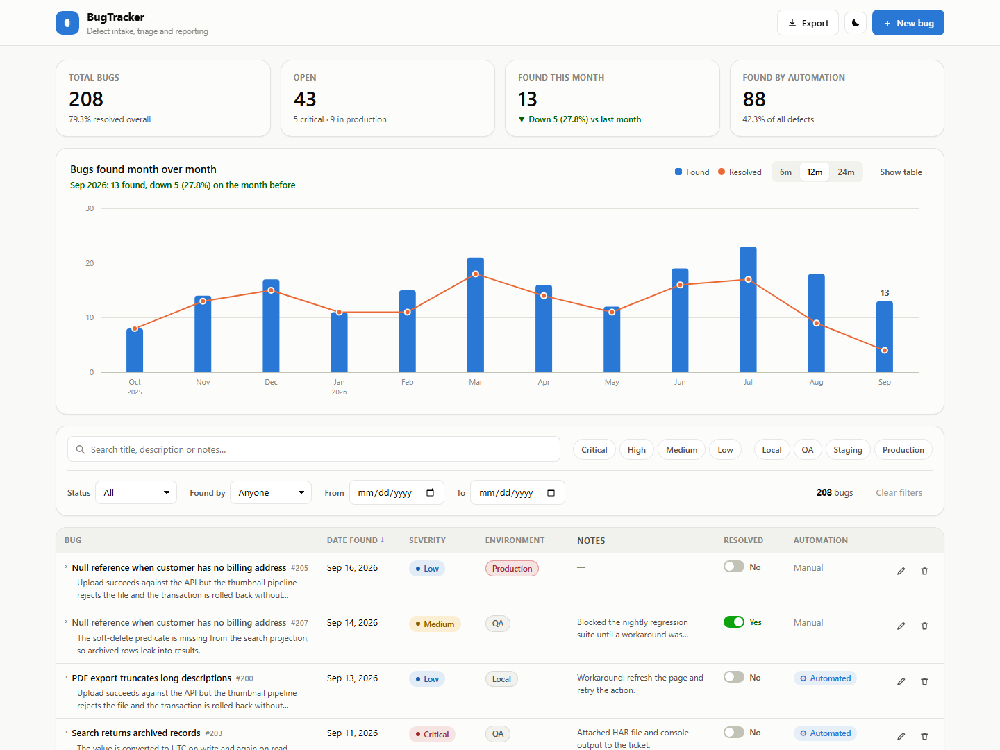
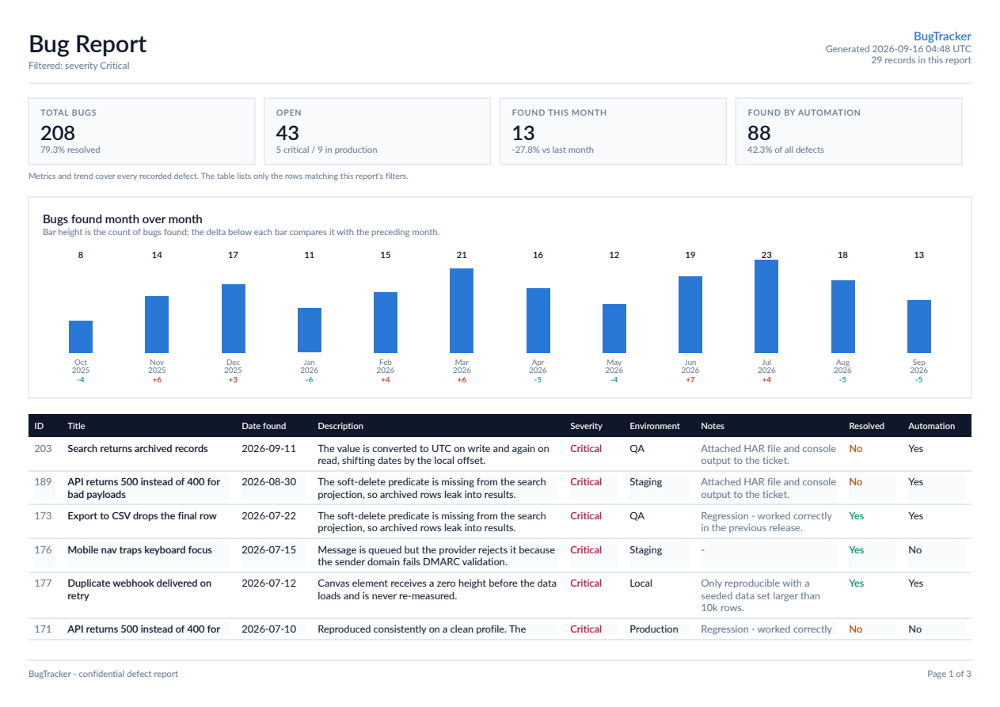

# BugTracker

A defect tracking application: **Vue 3 + Vite** front end, **ASP.NET Core 9** Web API, **SQL** persistence through EF Core (SQLite out of the box, SQL Server with one config change).

Log a bug, see it in the grid immediately, filter and sort it, flip its resolved flag, export the filtered set to CSV or PDF, and watch the month-over-month trend move.



---

## What it does

| Capability | Notes |
|---|---|
| **Log a bug** | Modal form with title, date found, description, severity, environment, notes, resolved flag and found-by-automation flag. Notes can be captured at creation time. |
| **See every bug** | Sortable, filterable grid. Rows expand to show the full description, notes and audit timestamps. |
| **Columns tracked** | Date found · description · severity · environment (Local / QA / Staging / Production) · notes · resolved (Yes/No) · found by automation (Yes/No). |
| **Filter** | Free-text search across title/description/notes, multi-select severity and environment, open/resolved, automation vs person, and a date-found range. |
| **Resolve inline** | Toggle in the grid patches the single flag; the API stamps the resolution date. |
| **Export** | CSV (RFC 4180, Excel-safe) and a printable PDF report. Both honour the filters currently applied — not just the visible page. Capped at 50,000 rows (CSV) and 2,000 rows (PDF); over the cap the API asks you to narrow the filters rather than truncating silently. |
| **Month-over-month graph** | Bars for bugs found, a line for bugs resolved, with the increase/decrease against the preceding month called out in the subtitle, in the tooltip and in a table view. 6 / 12 / 24 month ranges. |
| **Modern UI** | Light and dark themes, responsive down to phone width, keyboard-navigable, toast feedback. |

### The month-over-month chart



Bars and line share one axis (both are counts of bugs), so the chart never lies about scale. Colours come from a palette validated for colour-vision deficiency in both themes, and every direction cue carries a glyph and wording, never colour alone. The **Show table** toggle renders the same numbers as a table.

---

## Quick start

Prerequisites: **.NET 9 SDK** and **Node 20.19+**.

```powershell
./dev.ps1
```

That starts the API on <http://localhost:5174> and the client on <http://localhost:5173>, installing client dependencies on first run. Open <http://localhost:5173>.

The database is created automatically on first run. In **Development** it is seeded with 14 months of sample defects so the grid and the trend have something to show; any other environment starts empty. To start a dev database empty, set `Database:SeedSampleData` to `false` in `appsettings.Development.json` and delete `server/BugTracker.Api/bugtracker.db`.

### Running the two halves separately

```powershell
# Terminal 1 - API (Swagger at /swagger)
cd server/BugTracker.Api
dotnet run

# Terminal 2 - client
cd client
npm install
npm run dev
```

Vite proxies `/api` to `http://localhost:5174`, so the browser stays on one origin in development. Point it elsewhere with `VITE_API_PROXY_TARGET` (see `client/.env.example`).

### Production build

```powershell
./build.ps1 -Configuration Release -Output ./publish
dotnet ./publish/BugTracker.Api.dll
```

This builds the client, copies it into the API's `wwwroot`, and publishes the API. The result is a **single deployable** serving both the SPA and the JSON API from one origin, so no CORS configuration is needed in production.

---

## Project layout

```
BugTrackerApplication/
├── BugTracker.sln
├── dev.ps1                      # run API + client together
├── build.ps1                    # client build -> wwwroot -> dotnet publish
├── client/                      # Vue 3 + Vite
│   └── src/
│       ├── api/bugApi.js        # fetch wrapper, query builder, file downloads
│       ├── components/          # TrendChart, BugTable, FilterBar, BugFormModal, …
│       ├── composables/         # theme, toasts
│       ├── styles.css           # design tokens (light + dark)
│       └── App.vue              # dashboard shell and state
└── server/BugTracker.Api/       # ASP.NET Core 9
    ├── Domain/                  # Bug entity, Severity, BugEnvironment
    ├── Data/                    # DbContext, seeder
    ├── Contracts/               # request/response DTOs
    ├── Services/                # BugService, CsvBugExporter, PdfBugExporter
    ├── Controllers/             # BugsController
    └── Sql/schema.sql           # SQL Server DDL for review / pipeline deployment
```

---

## API

Base path `/api/bugs`. Swagger UI is at `/swagger` in development.

| Method | Route | Purpose |
|---|---|---|
| `GET` | `/api/bugs` | Filtered, sorted, paged list. |
| `GET` | `/api/bugs/{id}` | One bug. |
| `POST` | `/api/bugs` | Create. Returns `201` with the created bug. |
| `PUT` | `/api/bugs/{id}` | Full update. |
| `PATCH` | `/api/bugs/{id}/resolved` | Flip the resolved flag only. |
| `DELETE` | `/api/bugs/{id}` | Delete. |
| `GET` | `/api/bugs/stats/summary` | Dashboard tile counters. |
| `GET` | `/api/bugs/stats/monthly?months=12` | Month-over-month trend. |
| `GET` | `/api/bugs/export/csv` | CSV of every matching row. |
| `GET` | `/api/bugs/export/pdf` | PDF report of every matching row. |
| `GET` | `/health` | Liveness probe. |

**Query parameters** (shared by the list endpoint and both exports):

`search`, `severity` (repeatable), `environment` (repeatable), `resolved`, `foundByAutomation`, `from`, `to`, `sort` (`dateFound` \| `severity` \| `environment` \| `title` \| `resolved` \| `created`), `direction` (`asc` \| `desc`), `page`, `pageSize` (max 200).

```bash
# Open Critical/High defects in Production, found this year, as a PDF
curl -o report.pdf "http://localhost:5174/api/bugs/export/pdf?severity=Critical&severity=High&environment=Production&resolved=false&from=2026-01-01"
```

Enums travel as names (`"Critical"`, `"Production"`), dates as `yyyy-MM-dd`. Validation failures return RFC 9110 `ProblemDetails` with per-field errors, which the form surfaces next to the offending input.

---

## Data model

`Bugs` table, one row per defect:

| Column | Type | Notes |
|---|---|---|
| `Id` | int identity | |
| `Title` | nvarchar(200) | Short summary shown in the grid and reports. |
| `DateFound` | date | The date the defect was observed, not the insert date. |
| `Description` | nvarchar(4000) | |
| `Severity` | nvarchar(20) | `Critical` \| `High` \| `Medium` \| `Low` |
| `Environment` | nvarchar(20) | `Local` \| `QA` \| `Staging` \| `Production` |
| `Notes` | nvarchar(4000), null | Optional, capturable at creation. |
| `Resolved` | bit | |
| `DateResolved` | date, null | Stamped when `Resolved` flips to true, cleared when it flips back. |
| `FoundByAutomation` | bit | |
| `CreatedUtc` / `UpdatedUtc` | datetime2 | Maintained by the DbContext. |

Enums are persisted **as text** so the table stays readable to ad-hoc SQL and BI tools. Because of that, the API orders severity and environment through a `CASE` rank expression rather than alphabetically — `Critical` sorts first, `Production` last. Indexes cover `DateFound`, `Resolved`, and `(Severity, Environment)`.

### Switching to SQL Server

Change the provider in `server/BugTracker.Api/appsettings.json`:

```json
"Database": { "Provider": "SqlServer" },
"ConnectionStrings": {
  "SqlServer": "Server=(localdb)\\MSSQLLocalDB;Database=BugTracker;Trusted_Connection=True;TrustServerCertificate=True"
}
```

or set `DATABASE__PROVIDER=SqlServer` in the environment. Nothing else changes — the model, queries and rollups are provider-agnostic. `Sql/schema.sql` holds the equivalent DDL (with check constraints) for teams that apply schema through a release pipeline.

---

## Notes and trade-offs

- **Schema creation.** The app calls `EnsureCreated()` so it runs with zero setup on either provider. A real deployment should move to EF migrations (`dotnet ef migrations add Initial`) or apply `Sql/schema.sql` from the pipeline; `EnsureCreated` does not version the schema.
- **Trend rollup.** The monthly buckets are grouped in memory over a bounded two-column projection rather than in SQL, because `DateOnly` date-part translation differs between SQLite and SQL Server. At bug-tracker volumes this is cheap and keeps both providers identical; at millions of rows, move it into a provider-specific SQL query or an indexed view.
- **First bucket.** A month is only compared with the preceding month when that month is inside recorded history, so the oldest bar shows "no prior month" rather than a fake 100% rise.
- **PDF text.** Descriptions and notes are truncated in the PDF so rows stay whole across page breaks. The full text is always in the app and in the CSV.
- **CSV safety.** Values starting with `=`, `+`, `-` or `@` are prefixed with an apostrophe to defuse spreadsheet formula injection, and a UTF-8 BOM is emitted so Excel reads the encoding correctly.
---

## Security

### What's in place

- **Input handling** — EF Core parameterises every query; there is no raw SQL. Search terms are capped at 200 characters and LIKE wildcards (`%`, `_`, `[`) are escaped so they match literally. Page numbers are clamped so the SQL offset cannot overflow.
- **Request limits** — Write endpoints reject bodies over 128 KB with `413`. Exports are row-capped (`Exports:MaxCsvRows`, `Exports:MaxPdfRows`) because PDF rendering is CPU-heavy.
- **Output handling** — Vue interpolation escapes all rendered text, and nothing uses `v-html`. CSV cells that start with `=`, `+`, `-`, `@`, tab or carriage return are neutralised against formula injection.
- **Response headers** — `X-Content-Type-Options`, `X-Frame-Options: DENY`, `Referrer-Policy`, `Permissions-Policy`, and outside Development a strict `Content-Security-Policy` with no inline script or style. The `Server` header is suppressed.
- **Error responses** — Production returns `ProblemDetails` without stack traces, and malformed JSON gets a generic message instead of internal type names.
- **CORS** — Enabled in Development only. In production the SPA and API share an origin.
- **Build output** — Production client builds ship without source maps, and `.env*` files (except `.env.example`) are git-ignored.

### Before deploying beyond your machine

These depend on where and how you host the app, so they are deliberately left for you to decide:

1. **Add authentication and authorization.** The API is open: anyone who can reach it can read, edit, delete and export every bug. Put it behind your identity provider (for example Microsoft Entra ID or Auth0 with JWT bearer tokens) and add `[Authorize]` to the controller. If you choose cookie auth instead, add antiforgery protection to the write endpoints.
2. **Add rate limiting.** Use ASP.NET Core's built-in `AddRateLimiter`, with a tighter policy on `/api/bugs/export/*`. If you run behind a reverse proxy, configure forwarded headers first so limits partition on the real client IP.
3. **Set `AllowedHosts`** in production config to your real hostname(s). With the default `*`, a spoofed `Host` header is reflected into the `Location` header of `201 Created` responses.
4. **Terminate TLS and redirect HTTP.** Add `UseHttpsRedirection()`, or enforce HTTPS at your proxy and configure `ForwardedHeaders` so HSTS and redirects behave.
5. **Keep secrets out of `appsettings.json`.** Use environment variables, `dotnet user-secrets` locally, or a vault in production. The sample SQL Server connection string uses `TrustServerCertificate=True`, which is fine for LocalDB but disables certificate validation, so don't carry it over to a remote server.

---

## Roadmap ideas

Attachments and screenshots · comment threads and assignment · audit history per field · saved filter views · authentication and per-project scoping · a scheduled email of the weekly PDF.

---

## License

[MIT](LICENSE) © 2026 Rich Martinez.

Third-party dependencies keep their own licences. In particular, PDF export uses [QuestPDF](https://www.questpdf.com/license/) under its Community licence, which is free for individuals and organisations below its revenue threshold. Anyone reusing this code commercially above that threshold needs a QuestPDF licence, regardless of this project's MIT terms.
